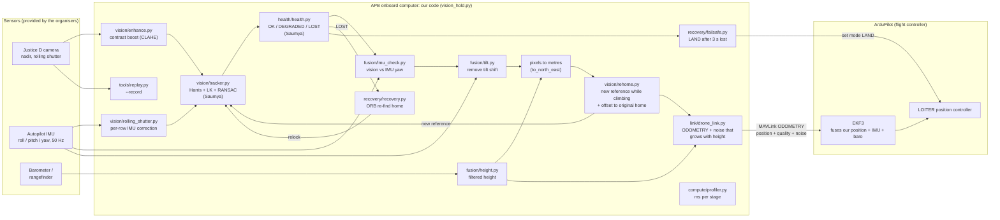
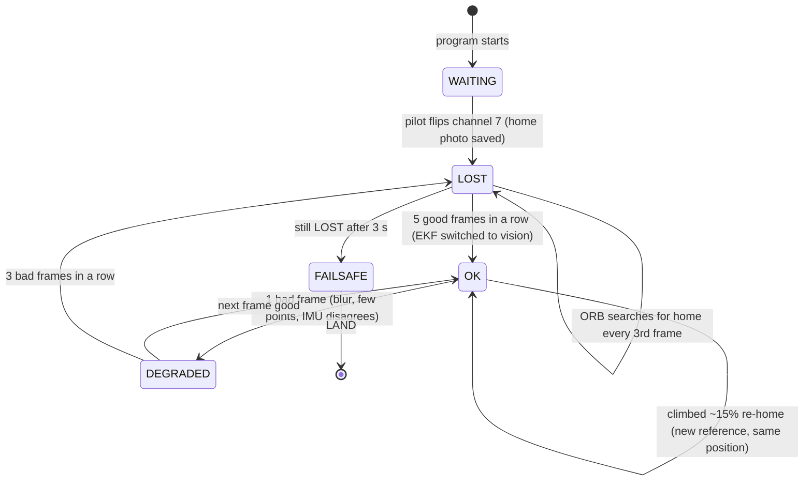
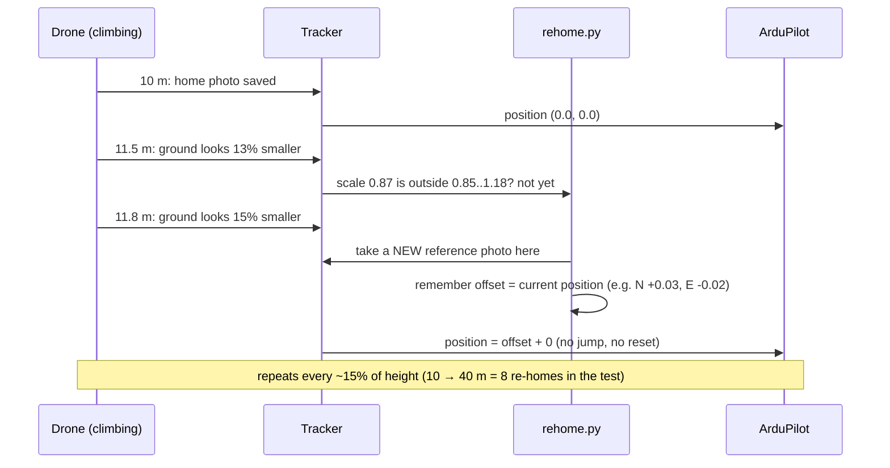
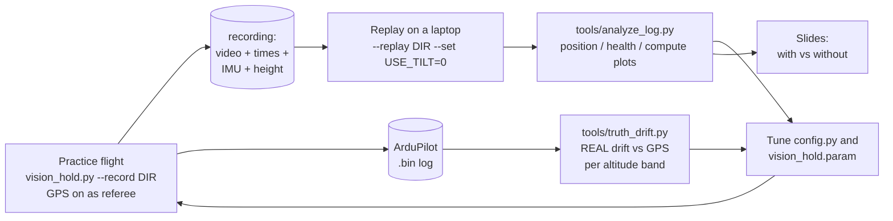

# DroneCode: Vision Position Hold Without GPS

**Red Team Hackathon Grand Final: Contested Battlefield Aerial Operations Challenge**

Hold an Orqa M2-AI drone still over one spot with **no GPS**, using only a cheap downward-facing
FPV camera (Justice D, rolling shutter), the drone's own motion sensors, and the APB onboard computer.
Whoever holds the steadiest position at the highest altitude wins.

> **Team decision: flight controller firmware = ArduPilot (≥ 4.5).** Not pursuing PX4, INAV or the optional
> Betaflight bonus route. `link/check_link.py` fails on anything else.

---

## Contents

1. [The idea in plain words](#1-the-idea-in-plain-words)
2. [Architecture](#2-architecture)
3. [What happens every frame](#3-what-happens-every-frame)
4. [Folder structure](#4-folder-structure)
5. [How the code answers the brief](#5-how-the-code-answers-the-brief)
6. [Setup](#6-setup)
7. [How to use it](#7-how-to-use-it)
8. [Flight control and tuning](#8-flight-control-and-tuning)
9. [Simulator testing step by step](#9-simulator-testing-step-by-step)
10. [Tests and results](#10-tests-and-results)
11. [Settings and on/off switches](#11-settings-and-onoff-switches)
12. [Team rules and conventions](#12-team-rules-and-conventions)
13. [Status and to-do](#13-status-and-to-do)
14. [Glossary](#14-glossary)

---

## 1. The idea in plain words

1. **Take a photo of the ground** when the pilot says "hold here". That spot is **home**.
2. **Every frame, find the same ground features again** (pebbles, edges, marks) and measure how far
   the picture has slid. If the ground slid left, the drone moved right.
3. **Clean up what the camera gets wrong.** The drone tilts to fly, which slides the picture without any
   real movement. The cheap camera also scans the image row by row ("rolling shutter"), which warps
   it when the drone shakes. The drone's motion sensors (IMU) tell us exactly how it tilted and
   shook, so we subtract those effects. High up, the view gets flat and hazy, so we **boost local contrast** first.
4. **Turn pixels into metres** using the height from the barometer or rangefinder.
5. **Climbing changes the picture size.** When the ground has shrunk or grown by about 15%, we take a
   **new reference photo** on the spot and keep counting from the original home, so the hold never breaks.
6. **Grade every measurement** (quality 1–100, or "don't trust") and send it to the autopilot with an error
   estimate that **grows with height** (one pixel covers more ground up high). The autopilot's EKF3 filter
   blends it with its own sensors and steers back to home.
7. **If vision fails** (blackout, dust, blur), tell the autopilot to ignore us, search for home
   again, and if it doesn't come back within 3 s, **land safely**.
8. **Record every practice flight** and replay it on the ground with features switched on or off, to tune
   settings and to make the "with vs without" plots, without flying again.

---

## 2. Architecture

### 2.1 The whole system



**Three layers:**

| Layer | Runs on | Job |
|---|---|---|
| **Sensing** | camera, IMU, barometer/rangefinder | raw pictures, angles, height |
| **Our vision pipeline** | APB (Python + OpenCV) | turns pictures into a trusted "metres from home" |
| **Final fusion and control** | ArduPilot EKF3 on the flight controller | blends our position with its own IMU, flies the drone |

The autopilot link is MAVLink (`link/drone_link.py`). We send `ODOMETRY` messages with a position, a quality
score and an error estimate, and we switch the EKF between GPS (source set 1) and our vision (source set 2).

### 2.2 Trust: how vision is judged, lost, recovered



While **OK**, our position is used. In **DEGRADED** and **LOST** we send quality −1, so ArduPilot ignores us and
coasts on its IMU and barometer.

### 2.3 Climbing: why re-homing is needed

The health check rejects a picture when the ground looks more than ~33% bigger or smaller than at home.
Climbing from 10 m to 40 m makes the ground look 4× smaller, so without re-homing vision is lost at ~13 m.



### 2.4 Practice and tuning loop (no extra flights needed)



---

## 3. What happens every frame

At 30 fps, each frame has a **33 ms budget**. Measured on a laptop: about **7–11 ms** in total (the APB will be slower:
measure it with `compute.benchmark`). Steps in the order `vision_hold.py` runs them:

| # | Step | File | Plain words |
|---|---|---|---|
| 1 | Grab | `vision_hold.py`, `compute/budget.py` | Read the newest picture and timestamp it; throw away stale ones |
| 2 | Contrast boost | `vision/enhance.py` | Bring out detail in flat, hazy views (leaves very dark/bright frames alone, so the alarms still work) |
| 3 | Record | `tools/replay.py` | Only with `--record`: save the frame, its time, the IMU and the height for replay |
| 4 | Home trigger | `vision_hold.py` | Pilot flipped channel 7? Save the home photo (rolling-shutter corrected) |
| 5 | Track | `vision/tracker.py` + `vision/rolling_shutter.py` | Find home's corners again, undo the rolling-shutter warp, measure slide + turn + scale |
| 6 | Health | `health/health.py` | Too dark? Blurry? Frozen? Enough agreeing points? → quality score, OK / DEGRADED / LOST |
| 7 | Height | `fusion/height.py` | Smooth the barometer/rangefinder height, ignore spikes |
| 8 | IMU check | `fusion/imu_check.py` | Does the camera's "we turned X°" match the compass? If not, don't trust this frame |
| 9 | Recovery | `recovery/recovery.py` | Only if LOST: search the whole picture for home and re-lock the tracker |
| 10 | Tilt | `fusion/tilt.py` | Subtract the fake slide caused by roll and pitch |
| 11 | Metres | `vision/tracker.py: to_north_east()` | pixels × height ÷ focal length → metres North/East, plus the re-home offset |
| 12 | Re-home | `vision/rehome.py` | Ground ~15% bigger/smaller (climb/descent)? New reference here, same position |
| 13 | Send | `link/drone_link.py` | ODOMETRY to ArduPilot: position, quality (−1 = "ignore me"), error that grows with height |
| 14 | Source / failsafe | `vision_hold.py`, `recovery/failsafe.py` | Switch the EKF to vision when trusted; LAND if lost for 3 s |
| 15 | Log | `logs/flight_*.csv` | One row per frame: position, status, corrections, re-homes, ms per stage |

---

## 4. Folder structure

```
DroneCode/
├── vision_hold.py            MAIN PROGRAM: runs the whole pipeline every frame (flies the drone)
├── config.py                 every new setting + on/off switch for each improvement
├── calib.npz                 lens calibration (made by calibration/)
├── timing.npz                rolling-shutter timing (made by calibrate_timing.py; not there until run)
├── requirements.txt          numpy, opencv-python, pymavlink, matplotlib
│
├── vision/                   ── BRIEF 1: seeing the ground ──
│   ├── tracker.py            Saumya: Harris corners, Lucas-Kanade, forward-backward check, RANSAC
│   ├── rolling_shutter.py    RollingShutterTracker = Saumya's tracker + per-row IMU correction
│   ├── rehome.py             new reference picture while climbing (keeps holding as height changes)
│   ├── enhance.py            picture prep: downscale to 640x360 (+ lens K) and local contrast boost
│   ├── timing.py             when each image row was captured (readout time, delay)
│   └── feature_filter.py     Saumya (to write): drop bad corners (legs in view, glare, moving things)
│
├── fusion/                   ── BRIEF 1: combining sensors ──
│   ├── tilt.py               remove fake motion from roll/pitch; rotation-matrix helpers
│   ├── height.py             smooth height, ignore spikes
│   └── imu_check.py          vision rotation vs IMU yaw: catches "healthy-looking" lies
│
├── compute/                  ── BRIEF 2: onboard compute ──
│   ├── profiler.py           stopwatch per stage, FPS, CPU %, memory
│   ├── budget.py             1-frame camera queue, drop stale frames
│   └── benchmark.py          run on the APB → table for the slide
│
├── health/                   ── BRIEF 3: detect ──
│   └── health.py             Saumya: quality 1..100, OK / DEGRADED / LOST with hysteresis
│
├── recovery/                 ── BRIEF 3: recover ──
│   ├── recovery.py           ORB search for home after LOST → tracker.relock()
│   └── failsafe.py           still lost after 3 s → LAND (once)
│
├── link/                     ── talking to the autopilot ──
│   ├── drone_link.py         Saumya: MAVLink background reader + ODOMETRY / source switching
│   └── check_link.py         pre-flight check → PASS / list of problems
│
├── ardupilot/
│   ├── vision_hold.param     ArduPilot settings: listen to vision, source sets, gentle hold, failsafe
│   └── load_params.py        write the settings over MAVLink + read each back (no Mission Planner needed)
│
├── calibration/
│   ├── calibrate.py          Saumya: lens calibration with a checkerboard (keys)
│   ├── auto_calibrate.py     Saumya: same, hands-free
│   └── calibrate_timing.py   measure readout time + camera-IMU delay (props OFF, shake the drone)
│
├── tools/
│   ├── analyze_log.py        flight log → position / health / compute plots + summary
│   ├── degrade_video.py      camera SIMULATOR (used by tests, incl. realistic terrain) + wobble/blur/blackouts
│   ├── replay.py             record a flight (--record) and replay it through the same code (--replay)
│   ├── truth_drift.py        ArduPilot .bin log → REAL drift vs GPS truth per altitude band
│   ├── discover_hardware.py  run on the APB: finds CPU/OS/Python, cameras, flight-controller port
│   ├── read_drone.py         Saumya: simplest MAVLink connection test
│   ├── fake_vision.py        Saumya: fake vision from the simulator's true position (Windows only)
│   └── ground_lock.py        Saumya: first ORB version, kept for reference
│
├── tests/                    ── the proof: each prints the numbers for the slides ──
│   ├── test_tracker.py       Saumya: tracker accuracy, signs, health checks
│   ├── test_tilt.py          tilt fix
│   ├── test_rolling_shutter.py  timing calibration + rolling-shutter fix
│   ├── test_health.py        IMU cross-check + height filter
│   ├── test_recovery.py      2 s and 10 s blackouts
│   ├── test_failsafe.py      failsafe timing
│   ├── test_params.py        param file says what the code needs + loader works
│   ├── test_rehome.py        climb 10 m → 40 m while holding
│   ├── test_replay.py        record once, replay with settings toggled
│   ├── test_truth_drift.py   real-drift calculator + ArduPilot log reader on known answers
│   ├── test_altitude.py      5–80 m sweep, normal and flat light, contrast boost on/off
│   ├── test_budget.py        stale-frame dropping: frame rate and data freshness
│   ├── test_process_scale.py 1280x720 vs 640x360: same metres, less work
│   └── common.py             the fixed test camera (tests never read the repo's calib.npz)
│
├── deploy/
│   ├── install.sh            one-shot setup on the APB (venv, self-test, boot service)
│   └── vision_hold.service   systemd: start at boot, restart on crash
│
├── docs/
│   ├── WORKLIST.md           TEAM TO-DO: every task with why / steps / done-when, phase by phase
│   ├── EVIDENCE.md           judging areas A–G: what we show, where it lives, what's missing
│   ├── hardware.md           facts from the OEM manuals: camera, APB, ports, login, day-1 checklist
│   └── presentation_notes.md slide → code → proof
└── logs/                     flight CSVs and benchmark reports (git-ignored)
```

**Every `.py` file starts with a header:** *IN PLAIN WORDS* (for anyone), *HOW IT WORKS* (technical),
*WHERE IT PLUGS IN*, and *REFERENCES* (papers and docs). Read the header first.

---

## 5. How the code answers the brief

| Brief asks | Our answer | Code | Proof |
|---|---|---|---|
| **Sensor fusion pipeline** | Camera tracking + IMU-based tilt and rolling-shutter correction + IMU yaw cross-check + filtered height, then EKF3 fuses it with its IMU using our quality score and a height-scaled error | `vision/`, `fusion/`, `ardupilot/` | `test_tilt`: 94 cm → 9.8 cm fake drift at 10° tilt; `test_replay`: tilt off on the same recording 3.8 → 50.2 cm |
| **Rolling shutter** | Measure readout time + delay from video and IMU, then move every tracked point to the frame's mid-row time | `vision/rolling_shutter.py`, `vision/timing.py`, `calibration/calibrate_timing.py` | `test_rolling_shutter`: 30 ms readout measured as 29 ms; 92% of rolling-shutter error removed |
| **Altitude (the trial)** | Re-home while climbing, contrast boost for flat/hazy views, EKF trusts us less as we climb | `vision/rehome.py`, `vision/enhance.py`, `link/drone_link.py` | `test_rehome`: 10 → 40 m climb, lost at 13.4 m without, 98.8% trusted with (100% above 15 m); `test_altitude`: flat light 40–80 m 0% → 91% trusted (the maximum: the first 4 frames rebuild trust) |
| **Onboard compute** | Everything on the APB; 1280×720 shrunk to 640×360 (same metres); every stage timed every frame; stale frames dropped by age | `compute/`, `vision/enhance.py` | `compute.benchmark`: ~7 ms/frame on a laptop (budget 33 ms); `test_budget`: 20 → 50 fps vs the old drop rule. APB run to do |
| **Detect and recover** | Health + IMU check detect; quality −1 lets the EKF coast; ORB re-finds home; LAND after 3 s | `health/`, `fusion/imu_check.py`, `recovery/` | `test_recovery`: trusted again 0.2 s after 2 s and 10 s blackouts (never without it) |

Slide-by-slide notes: [`docs/presentation_notes.md`](docs/presentation_notes.md).

> **New to the team? Start here:** [`docs/WORKLIST.md`](docs/WORKLIST.md) (what to do next, with context),
> [`docs/hardware.md`](docs/hardware.md) (what hardware we have) and [`docs/EVIDENCE.md`](docs/EVIDENCE.md)
> (what the judges score, A–G, and our evidence for each).

---

## 6. Setup

Python 3.10+ recommended.

```bash
git clone https://github.com/Sj011106/DroneCode
cd DroneCode
python -m venv venv
venv\Scripts\activate              # Windows
source venv/bin/activate           # Linux / macOS / APB
pip install -r requirements.txt
python -m tests.test_tracker       # should end with ALL TESTS PASSED
```

**On the APB** (log in with `ssh root@192.168.75.1` over the USB-C cable, copy the repo with
`rsync -avP DroneCode root@192.168.75.1:~`): `sh deploy/install.sh` does all of the above and installs
(but doesn't enable) the boot service. On the APB, run everything as **`venv/bin/python -m ...`**.

> **If the boot service is enabled, stop it before ANY manual run:** `systemctl stop vision_hold`.
> Two programs on one camera or serial port break each other.

> **Always run from the repo root** with `python -m folder.file` (not `python folder/file.py`),
> otherwise imports and `calib.npz` won't be found.

---

## 7. How to use it

### Once per camera (before the event)

```bash
venv/bin/python -m tools.discover_hardware --route-fc-uart   # what's connected (camera number, FC port)
venv/bin/python -m calibration.auto_calibrate 2               # lens → calib.npz (checkerboard, 1280x720)
venv/bin/python -m calibration.calibrate_timing --camera 2 --connect /dev/ttymxc2   # PROPS OFF → timing.npz
venv/bin/python -m compute.benchmark                          # → logs/benchmark_*.md for the slide
```

### Every flight

```bash
systemctl stop vision_hold                                    # only if the boot service is running
venv/bin/python -m link.check_link --connect /dev/ttymxc2     # must say PASS (ArduPilot >= 4.5, params)
venv/bin/python vision_hold.py --connect /dev/ttymxc2 --camera 2 --trigger rc --no-gps-fallback --record
```

**ArduPilot settings** (once, drone disarmed, then reboot the flight controller):

```bash
venv/bin/python -m ardupilot.load_params --connect /dev/ttymxc2           # write + read back every value
venv/bin/python -m ardupilot.load_params --connect /dev/ttymxc2 --verify  # only check (check_link does too)
```

What the settings do (details in the comments of `ardupilot/vision_hold.param`):

| Group | Key parameters | Why |
|---|---|---|
| Use EKF3 | `AHRS_EKF_TYPE 3`, `EK3_ENABLE 1`, `AHRS_GPS_USE 0` | EKF3 accepts external navigation; backup estimator must not trust spoofed GPS |
| Listen to vision | `VISO_TYPE 1`, `VISO_DELAY_MS 50`, `VISO_QUAL_MIN 30` | accept our ODOMETRY; tell it how old our data is; ignore low-quality frames |
| Source set 1 | `EK3_SRC1_* = GPS / baro / compass` | normal flying |
| Source set 2 | `EK3_SRC2_POSXY 6` (vision), `POSZ 1` (baro), `YAW 1` (compass), `EK3_SRC_OPTIONS 0` | position from us; height and heading never from vision; no spoofed GPS velocity |
| Gentle hold | `ANGLE_MAX 2000`, `LOIT_SPEED 500`, `LOIT_ACC_MAX 250` | small tilts keep the ground in view and the tilt fix accurate |
| Safety | `FS_EKF_ACTION 1`, `RC7_OPTION 0` | EKF failsafe lands; RC7 is our home switch |
| From the spec | serial port, GPS off, rangefinder (commented out) | wrong serial port can break the RC receiver: fill in only from the spec |

`load_params` refuses to write while the motors are armed, never overwrites an RC channel that already has a
function (unless `--force`), maps renamed parameters on newer ArduPilot (e.g. `ANGLE_MAX` → `ATC_ANGLE_MAX`), and
fails if any parameter is missing.

**In the air** (the event pilots fly): take off in ALT_HOLD → at the test position, channel 7 → home is saved
and the program switches the EKF to vision once health says OK → the pilot engages the hold (LOITER).
GPS may help during setup only, never in the scored hold: always `--no-gps-fallback` in the trial.

Useful `vision_hold.py` options:

| Option | Use |
|---|---|
| `--trigger rc / mode / start` | when to save home: RC switch (real flight), entering LOITER (simulator), at once (bench) |
| `--camera 2` or `--camera video.mp4` | live camera by number or path (Justice D = `2` = `/dev/video2`) or a recorded video |
| `--fixed-height 0.5` | bench test: webcam 0.5 m above a table |
| `--show` | preview window with status |
| `--no-gps-fallback` | never switch back to GPS |
| `--record [DIR]` | also save grey 640×360 video + times + attitude + height for replay (no DIR: `/sdcard/rec_<time>`, or `logs/` without a card) |
| `--replay DIR` | run on a recording instead of camera + drone (as fast as possible) |
| `--set NAME=VALUE` | override a `config.py` setting, e.g. `--set USE_TILT=False` |
| `--log PATH` | name of the flight log |

### After a flight

```bash
python -m tools.analyze_log                        # newest log → docs/plots/*.png + summary
python -m tools.truth_drift 00000042.BIN            # ArduPilot log: REAL drift vs GPS per altitude band
```

**Fly with `--record`** in practice, then make the "with vs without" comparisons on the ground from that one flight:

```bash
python vision_hold.py --replay logs/rec_1 --log logs/all_on.csv
python vision_hold.py --replay logs/rec_1 --log logs/no_tilt.csv --set USE_TILT=False
python vision_hold.py --replay logs/rec_1 --log logs/no_rs.csv   --set USE_ROLLING_SHUTTER=False
python -m tools.analyze_log logs/no_tilt.csv
```

**Practice flights:** keep the GPS receiver ON as a referee (the EKF flies on source set 2 = vision, GPS is only
logged), then `tools.truth_drift` gives the real drift the judges would measure.

### Simulator (no drone)

See [section 9](#9-simulator-testing-step-by-step).

---

## 8. Flight control and tuning

### Who flies the drone

**We don't write a position controller. ArduPilot flies.** Our job is to give it a trustworthy position;
its job is to fly to that position. This is the standard design for companion-computer navigation, and the
presentation story: *"we built a trustworthy position sensor from a cheap camera, and a proven controller flies on it."*

```
 APB (our Python, ~30 Hz)               Flight controller (ArduPilot, ~400 Hz)
┌──────────────────────────┐            ┌─────────────────────────────────────────────┐
│ camera → tracker → health│  ODOMETRY  │  EKF3: blends our position + IMU + baro     │
│ → RS/tilt fix → metres   │──────────► │        → best estimate of position/velocity │
│ "0.3 m N of home,        │  MAVLink   │                    │                        │
│  quality 85, ±0.17 m"    │            │  LOITER position controller (cascade):      │
└──────────────────────────┘            │   position error → target velocity          │
                                        │   velocity error → target acceleration      │
                                        │   acceleration   → lean angle (roll/pitch)  │
                                        │   angle error    → rotation rate            │
                                        │   rate error     → motor outputs            │
                                        └─────────────────────────────────────────────┘
```

**One correction, step by step:** wind pushes the drone 0.3 m north → the camera sees the ground slide → we send
"N = +0.30 m" → EKF3 blends it with the accelerometers (the IMU fills the gaps between our 30 Hz frames, and
`VISO_DELAY_MS` lines our late measurement up with the right moment) → the position loop asks for ~0.3 m/s south →
the velocity loop asks for an acceleration → the drone leans a few degrees south → error shrinks.
That lean is exactly the fake motion `fusion/tilt.py` removes. Without the fix, every correction would look like new drift.

### How much ArduPilot trusts us

Checked in ArduPilot's source (`AP_VisualOdom_MAV.cpp`):

- **Noise:** EKF3 uses `sqrt(var_x + var_y + var_z)` from the covariance in our ODOMETRY message, but never less
  than `VISO_POS_M_NSE`. We set that floor to its minimum (0.1 m) so our numbers decide.
- **Our numbers grow with height** (`link/drone_link.py: odometry_sigma_px`, `config.ODOM_PX_NOISE_*`): one pixel
  covers more ground higher up, so the same tracking error means more metres. Saumya's quality-based formula stays
  the minimum; above ~40 m the height-based value takes over (quality 50: 0.17 m → 0.42 m per axis at 100 m).
- **Quality** is only a gate: below `VISO_QUAL_MIN` (30) the message is dropped. It doesn't change the noise.

### When vision degrades

| Our status | What we send | What ArduPilot does |
|---|---|---|
| OK | position + quality + noise | holds position |
| DEGRADED (1–2 bad frames) | quality −1 | coasts on IMU + barometer for a few hundred ms, which is fine |
| LOST | quality −1 every frame | dead-reckons; its uncertainty grows while `recovery.py` searches for home |
| LOST > 3 s | our failsafe switches to LAND | lands in place |
| EKF estimate bad | (backup) | `FS_EKF_ACTION 1` → lands |

### What we tune (in this order)

| # | Knob | Where | How |
|---|---|---|---|
| 1 | Airframe gains (`ATC_*`) | ArduPilot | Once, on GPS, before any vision work (AutoTune). Never touch them for vision |
| 2 | `VISO_DELAY_MS` | `ardupilot/vision_hold.param` | Start at −offset from `timing.npz` + mean `ms_total` from a flight log + ~5 ms. Then step ±10–20 ms |
| 3 | `ODOM_PX_NOISE_BEST/WORST` | `config.py` | Twitchy hold → raise. Slow, lazy corrections → lower |
| 4 | `PSC_POSXY_P` | ArduPilot | Overshoots home → lower. Drifts far before correcting → raise. Default 1.0 |
| 5 | `LOIT_ACC_MAX`, `ANGLE_MAX` | `ardupilot/vision_hold.param` | Already reduced. Lower = smaller tilts = clearer images |

**Reading the symptoms:**

| What the drone does | Likely cause | Fix |
|---|---|---|
| Slow swaying back and forth (1–3 s period) | `VISO_DELAY_MS` wrong | step it ±20 ms, keep the better one |
| Fast jitter or twitching | EKF trusts noisy vision too much | raise `ODOM_PX_NOISE_*` |
| Circles around home ("toilet-bowling") | heading wrong (compass) | compass calibration; `imu_check` will log disagreements |
| Steady drift in one direction | sign or axis wrong, or wrong camera orientation | bench test with `--fixed-height`, check `tracker.py` sign convention |
| Holds low, gets worse higher up | normal: features shrink, pixel noise grows | more texture, better focus, higher `ODOM_PX_NOISE_*`, slower `LOIT_*` |

### Why not write our own controller?

We could (GUIDED mode, sending velocity commands), but it puts a 30 Hz Python loop in charge of flying, skips
ArduPilot's tested safety logic, and adds a second controller that can fight the first. The judges score the
fusion pipeline, onboard compute and recovery, not a hand-written PID.

---

## 9. Simulator testing step by step

The simulator (SITL) runs real ArduPilot on a PC with a virtual drone. Use it to practise the procedure and tune
before risking hardware.

### Step 1: start the simulator

**Windows (Mission Planner):** Simulation tab → choose **Multirotor** → it downloads and starts ArduCopter SITL
and connects. Our tools connect to the second port, `tcp:127.0.0.1:5762` (the default in all our tools).

**Linux:** `sim_vehicle.py -v ArduCopter --console --map --out=udp:127.0.0.1:14551`, then use
`--connect udp:127.0.0.1:14551` with our tools. (`tools/fake_vision.py` is Windows-only and fixed to 5762.)

### Step 2: load our ArduPilot settings

```bash
python -m ardupilot.load_params --connect tcp:127.0.0.1:5762
```

Restart the simulator (some settings need a reboot), then check:

```bash
python -m link.check_link --connect tcp:127.0.0.1:5762      # should say PASS
```

The hardware section of the param file stays commented out in the simulator. GPS stays on so the drone can take off normally.

### Step 3: tune the autopilot side with perfect fake vision

This tests ArduPilot's behaviour alone, with a clean position and no camera.

1. Mission Planner → Actions: **Arm**, mode **GUIDED**, right-click the map → **Takeoff** to 10 m, then mode **LOITER**.
2. Run `py -m tools.fake_vision`. It sends the simulator's true position plus 2 cm of noise. Press **v**: the EKF switches to source set 2 (vision).
3. Turn GPS off in the simulator: Full Parameter List → search `SIM_GPS` → disable it (`SIM_GPS_DISABLE = 1`; the
   name differs between firmware versions). The drone must keep holding.
4. Add wind (`SIM_WIND_SPD 5`, `SIM_WIND_DIR 90`) and watch how far it drifts.
5. Experiments (edit locally, **don't commit**): raise `NOISE_M` in `tools/fake_vision.py` to 0.1–0.3 m and watch when
   the hold turns twitchy; step `VISO_DELAY_MS` from 0 to 150 and watch when it starts swaying. Fake vision has
   almost no delay, so this shows how *sensitive* the hold is. The real value comes from the drone.

### Step 4: test our real pipeline's plumbing

```bash
python -m tools.degrade_video flight.mp4 test.mp4 --blackout 10 6       # 6 s blackout at 10 s
python vision_hold.py --camera test.mp4 --trigger mode --no-gps-fallback --show
```

Switch the simulator to LOITER: home is saved, vision becomes OK, source set 2 is selected, and the blackout leads
to LOST and then FAILSAFE → LAND after 3 s. The video doesn't match the simulated motion, so this checks the
**sequence** (home, switching, quality, failsafe), not hold accuracy.

### Step 5: read the results

```bash
python -m tools.analyze_log            # our side: position, health timeline, ms per stage
```

On the ArduPilot side, open the flight log in Mission Planner (Ctrl+F → Review a Log) and compare our vision
positions with the EKF position (`XKF1` PN/PE). Large gaps or slow swings mean `VISO_DELAY_MS` or the noise needs tuning.

---

## 10. Tests and results

```bash
python -m tests.test_tracker            # Saumya: tracker < 1 px error, signs, health checks
python -m tests.test_tilt               # tilt fix
python -m tests.test_rolling_shutter    # timing calibration + rolling-shutter fix
python -m tests.test_health             # IMU cross-check + height filter
python -m tests.test_recovery           # blackouts (~45 s)
python -m tests.test_failsafe           # failsafe timing
python -m tests.test_params             # ArduPilot param file + loader
python -m tests.test_rehome             # climb 10 → 40 m (~1 min)
python -m tests.test_replay             # record + replay + toggles (~1 min)
python -m tests.test_truth_drift        # real-drift calculator
python -m tests.test_altitude           # 5–80 m sweep (~1 min)
python -m tests.test_budget             # stale-frame dropping
python -m tests.test_process_scale      # 1280x720 vs 640x360
```

The tests use a **camera simulator** (`tools/degrade_video.py: render()`) that draws what the
downward camera sees for any position, tilt and rolling-shutter timing, so every test knows the true answer.

| Test | Result (simulated) |
|---|---|
| Tracker | worst error 0.01 px |
| Tilt | fake drift 94 cm → 9.8 cm at 10° tilt (removes 90%) |
| Rolling shutter | readout 30 → 29 ms, delay −20 → −19 ms measured; 92% of rolling-shutter error removed |
| IMU check | 20° disagreement rejected, agreement within 0.01° |
| Recovery | 2 s and 10 s blackouts with 1–2 m drift: trusted again in 0.2 s (without recovery: never) |
| Failsafe | fires once, 3.0 s after loss, re-arms after recovery; resends the mode until the autopilot confirms (gives up after 5 and tells the pilot); fires when health says OK but no valid position is sent |
| Params | 32 settings match what the code needs; loader verifies, writes, maps renamed params, won't overwrite a used RC channel; ArduPilot 4.4 flagged as too old; noise sent grows with height above ~40 m |
| Re-home (climb 10 → 40 m) | without: trust lost at 13.4 m (15.8% trusted); with: 98.8% trusted (100% above 15 m), 8 re-homes, error mean 6.7–8.0 cm, max 15 cm |
| Replay | identical results on repeat; live run (rocking attitude, RS fix on) reproduced 90/90 frames; tilt fix off → error 3.8 → 50.2 cm; RS fix off → trusted frames 94 → 56 |
| Truth drift | known drift / vision error / EKF error recovered per altitude band to < 1 cm; log reader: hold start = switch to LOITER, 2nd GPS ignored, vision resets don't count as error |
| Altitude sweep | error ~0.6 px at every height = 0.7 cm at 5 m → 12 cm at 80 m; flat light at 40–80 m: 0% trusted without contrast boost, 91% with it (= every frame after the 5-frame trust delay) |
| Budget | 20 ms per frame, 1-frame queue: 20 → 50 fps vs the old rule; 4-frame queue: data age 76 → 22 ms |
| Process scale | 1280×720 vs 640×360: positions agree within 0.02 cm |

The simulated tests use a fixed test camera (`tests/common.py`), so committing the real Justice D calibration
does not change these numbers.

---

## 11. Settings and on/off switches

New settings live in **`config.py`**. Saumya's settings stay at the top of her files.

| Switch | Turns on/off |
|---|---|
| `USE_ROLLING_SHUTTER` | per-row rolling-shutter correction |
| `USE_TILT` | tilt cancellation |
| `USE_IMU_CHECK` | vision vs IMU yaw cross-check |
| `USE_HEIGHT_FILTER` | height smoothing |
| `USE_RECOVERY` | ORB re-find home |
| `USE_REHOME` | new reference picture while climbing/descending (`REHOME_SCALE_MIN/MAX`) |
| `USE_CLAHE` | local contrast boost before tracking + health (`CLAHE_CLIP`, `CLAHE_TILES`) |
| `PROCESS_WIDTH` | shrink frames before tracking (640; `None` = full 1280×720) |
| `FAILSAFE_ACTION` | `"LAND"` (default), `"ALT_HOLD"` or `"NONE"` |

Switching one off and flying or replaying the same recording (`--replay DIR --set NAME=False`) gives the
"with vs without" plot for the slides.

---

## 12. Team rules and conventions

- **Don't rewrite Saumya's logic** (`tracker.py`, `health.py`, `drone_link.py`, calibration). Improve
  *around* it: subclass it (`RollingShutterTracker`), wrap it, or add a step in `vision_hold.py`.
  Additions in `vision_hold.py` are marked `# NEW`.
- **Sign convention** (top of `vision/tracker.py`): `shift_px` = how far the drone moved from home,
  in image axes (+x = right, +y = down). Camera points straight down, **top of the image = nose**.
  `to_north_east()` turns it into metres +North / +East.
- **Angles**: radians, ZYX (yaw, pitch, roll), same as ArduPilot's ATTITUDE message.
- **Every new feature gets**: a header (plain words + technical + references), an on/off switch in
  `config.py`, and a test in `tests/` that prints a number for the slides.
- **Run from the repo root** with `python -m ...` (`venv/bin/python -m ...` on the APB).
- **Stop the boot service before any manual run** (`systemctl stop vision_hold`).
- **Flight controller: ArduPilot ≥ 4.5 only** (team decision).
- **Commit to `main` only when agreed.** Use `git add -A` so moved files keep their history.

---

## 13. Status and to-do

| Item | Status |
|---|---|
| Tracker, health, MAVLink link | ✅ Saumya |
| Rolling shutter + timing calibration | ✅ simulated; **calibrate on the real Justice D** |
| Tilt, height filter, IMU check | ✅ |
| Recovery + failsafe | ✅ |
| Profiler, budget, benchmark | ✅; **run the benchmark on the APB** |
| Log analysis plots | ✅ |
| Re-home while climbing | ✅ simulated; **test in flight: climb in steps, watch `Re-homed` messages** |
| Record + replay | ✅; **fly every practice flight with `--record`** |
| Real drift vs GPS (`truth_drift`) | ✅ logic tested on synthetic data; **first real .bin log still to check (field names)** |
| Altitude sweep + contrast boost | ✅ simulated; **check sharpness / trust on real footage at height** |
| `vision/feature_filter.py` | ⬜ Saumya |
| Real flight logs and plots | ⬜ SITL, then the drone |
| `docs/architecture.png` for slides | ⬜ (the diagram in section 2 can be exported) |
| ArduPilot param file + loader | ✅; **tune `VISO_DELAY_MS` after calibrate_timing** |
| Trust that scales with height (ODOMETRY noise) | ✅; **tune `ODOM_PX_NOISE_*` from flight logs** |
| SITL procedure | ✅ documented (section 9); **run it** |
| Values from the technical spec | 🟡 OEM facts in (`docs/hardware.md`, `deploy/`); Stage 2 items still open |
| ArduPilot ≥ 4.5 build for the APB FC | ⬜ **confirm with the organisers** (stock firmware appears to be Betaflight) |
| Justice D lens calibration | ⬜ `calib.npz` is still a webcam's: recalibrate at 1280×720 |
| Evidence for judging areas A–G | 🟡 `docs/EVIDENCE.md` |

**Known limits:** the tilt fix only corrects the main effect of tilting, leaving about 2 px of error
at 5° and 9 px at 10° (see `fusion/tilt.py`). Rolling-shutter correction covers rotation only;
movement during the ≤ 16.7 ms scan is tiny at altitude. Each re-home freezes in the error of that moment, so error
can grow a little per re-home (climb test: 1.5 cm → 7–8 cm over 8 re-homes). Simulated terrain is a model:
real ground texture at height must be checked on footage. Recommendation for Saumya: `health.BLUR_BAD` is an
absolute threshold; making it relative to the home frame's sharpness would remove the flat-light false alarm
at its root (the contrast boost works around it).

---

## 14. Glossary

| Term | Meaning |
|---|---|
| **GNSS / GPS** | Satellite positioning. Jammed or spoofed in this challenge |
| **VIO** | Visual-Inertial Odometry: estimating motion from camera + motion sensors |
| **IMU** | Inertial Measurement Unit: gyroscopes + accelerometers; gives roll, pitch, yaw |
| **Nadir camera** | Camera pointing straight down |
| **Rolling shutter** | Camera that captures rows one after another, so fast motion warps the image |
| **Readout time** | How long the camera takes to scan top row → bottom row |
| **Roll / pitch / yaw** | Tilting sideways / tilting nose up-down / turning left-right |
| **Home** | The spot (and its ground photo) the drone must hold over |
| **Feature / corner** | A small distinctive patch of ground the tracker can find again |
| **Harris / LK / ORB** | Corner detector / frame-to-frame point tracker / feature fingerprint matcher |
| **RANSAC** | Finds the motion most points agree on and ignores the liars |
| **EKF3** | ArduPilot's Extended Kalman Filter: blends all sensors into one position estimate |
| **MAVLink / ODOMETRY** | The drone's message protocol / the message we send our position in |
| **Quality** | Our trust score: 1–100, or −1 = "ignore this measurement" |
| **OK / DEGRADED / LOST** | Trusted / one bad frame / not trusted until 5 good frames in a row |
| **Relock** | Recovery found home again and gave the tracker a fresh starting point |
| **SITL** | Software-In-The-Loop: ArduPilot simulator on a PC |
| **APB** | The onboard computer that runs our code |

---

## Team

Praise Chopde · Ayush Ahir · Saumya J · Divyanshi Kashyap
