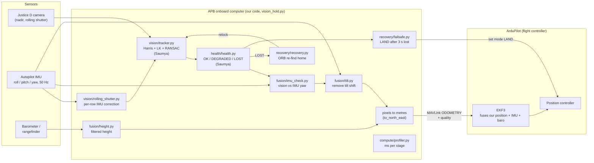

# DroneCode: Vision Position Hold Without GPS

**Red Team Hackathon Grand Final: Contested Battlefield Aerial Operations Challenge**

Hold an Orqa M2-AI drone still over one spot with **no GPS**, using only a cheap downward-facing
FPV camera (Justice D, rolling shutter), the drone's own motion sensors, and the APB onboard computer.
Whoever holds the steadiest position at the highest altitude wins.

---

## Contents

1. [The idea in plain words](#1-the-idea-in-plain-words)
2. [Architecture](#2-architecture)
3. [What happens every frame](#3-what-happens-every-frame)
4. [Folder structure](#4-folder-structure)
5. [How the code answers the brief](#5-how-the-code-answers-the-brief)
6. [Setup](#6-setup)
7. [How to use it](#7-how-to-use-it)
8. [Tests and results](#8-tests-and-results)
9. [Settings and on/off switches](#9-settings-and-onoff-switches)
10. [Team rules and conventions](#10-team-rules-and-conventions)
11. [Status and to-do](#11-status-and-to-do)
12. [Glossary](#12-glossary)

---

## 1. The idea in plain words

1. **Take a photo of the ground** when the pilot says "hold here". That spot is **home**.
2. **Every frame, find the same ground features again** (pebbles, edges, marks) and measure how far
   the picture has slid. If the ground slid left, the drone moved right.
3. **Clean up what the camera gets wrong.** The drone tilts to fly, which slides the picture without any
   real movement. The cheap camera also scans the image row by row ("rolling shutter"), which warps
   it when the drone shakes. The drone's motion sensors (IMU) tell us exactly how it tilted and
   shook, so we subtract those effects.
4. **Turn pixels into metres** using the height from the barometer or rangefinder.
5. **Grade every measurement** (quality 1–100, or "don't trust") and send it to the autopilot.
   The autopilot's EKF3 filter blends it with its own sensors and steers back to home.
6. **If vision fails** (blackout, dust, blur), tell the autopilot to ignore us, search for home
   again, and if it doesn't come back within 3 s, **land safely**.

---

## 2. Architecture



**Three layers:**

| Layer | Runs on | Job |
|---|---|---|
| **Sensing** | camera, IMU, barometer/rangefinder | raw pictures, angles, height |
| **Our vision pipeline** | APB (Python + OpenCV) | turns pictures into a trusted "metres from home" |
| **Final fusion and control** | ArduPilot EKF3 on the flight controller | blends our position with its own IMU, flies the drone |

The autopilot link is MAVLink (`link/drone_link.py`). We send `ODOMETRY` messages with a quality
score, and we switch the EKF between GPS (source set 1) and our vision (source set 2).

---

## 3. What happens every frame

At 30 fps, each frame has a **33 ms budget**. Measured on a laptop: about **10 ms** in total.

| # | Step | File | Plain words |
|---|---|---|---|
| 1 | Grab | `vision_hold.py`, `compute/budget.py` | Read the newest picture and timestamp it; throw away stale ones |
| 2 | Track | `vision/tracker.py` + `vision/rolling_shutter.py` | Find home's corners again, undo the rolling-shutter warp, measure slide + turn |
| 3 | Health | `health/health.py` | Too dark? Blurry? Frozen? Enough agreeing points? → quality score |
| 4 | IMU check | `fusion/imu_check.py` | Does the camera's "we turned X°" match the compass? If not, don't trust it |
| 5 | Recovery | `recovery/recovery.py` | Only if LOST: search the whole picture for home and re-lock |
| 6 | Tilt | `fusion/tilt.py` | Subtract the fake slide caused by roll and pitch |
| 7 | Metres | `vision/tracker.py: to_north_east()` + `fusion/height.py` | pixels × height ÷ focal length → metres North/East |
| 8 | Send | `link/drone_link.py` | ODOMETRY message to ArduPilot (quality −1 = "ignore me") |
| 9 | Source / failsafe | `vision_hold.py`, `recovery/failsafe.py` | Switch the EKF to vision when trusted; LAND if lost too long |
| 10 | Log | `logs/flight_*.csv` | One row per frame, including ms per stage |

---

## 4. Folder structure

```
DroneCode/
├── vision_hold.py            MAIN PROGRAM: runs the whole pipeline every frame (flies the drone)
├── config.py                 every new setting + on/off switch for each improvement
├── calib.npz                 lens calibration (made by calibration/)
├── timing.npz                rolling-shutter timing (made by calibrate_timing.py; not there until run)
├── requirements.txt          numpy, opencv-python, pymavlink, matplotlib
│
├── vision/                   ── BRIEF 1: seeing the ground ──
│   ├── tracker.py            Saumya: Harris corners, Lucas-Kanade, forward-backward check, RANSAC
│   ├── rolling_shutter.py    RollingShutterTracker = Saumya's tracker + per-row IMU correction
│   ├── timing.py             when each image row was captured (readout time, delay)
│   └── feature_filter.py     Saumya (to write): drop bad corners (legs in view, glare, moving things)
│
├── fusion/                   ── BRIEF 1: combining sensors ──
│   ├── tilt.py               remove fake motion from roll/pitch; rotation-matrix helpers
│   ├── height.py             smooth height, ignore spikes
│   └── imu_check.py          vision rotation vs IMU yaw: catches "healthy-looking" lies
│
├── compute/                  ── BRIEF 2: onboard compute ──
│   ├── profiler.py           stopwatch per stage, FPS, CPU %, memory
│   ├── budget.py             1-frame camera queue, drop stale frames
│   └── benchmark.py          run on the APB → table for the slide
│
├── health/                   ── BRIEF 3: detect ──
│   └── health.py             Saumya: quality 1..100, OK / DEGRADED / LOST with hysteresis
│
├── recovery/                 ── BRIEF 3: recover ──
│   ├── recovery.py           ORB search for home after LOST → tracker.relock()
│   └── failsafe.py           still lost after 3 s → LAND (once)
│
├── link/                     ── talking to the autopilot ──
│   ├── drone_link.py         Saumya: MAVLink background reader + ODOMETRY / source switching
│   └── check_link.py         pre-flight check → PASS / list of problems
│
├── ardupilot/
│   ├── vision_hold.param     ArduPilot settings: listen to vision, source sets, gentle hold, failsafe
│   └── load_params.py        write the settings over MAVLink + read each back (no Mission Planner needed)
│
├── calibration/
│   ├── calibrate.py          Saumya: lens calibration with a checkerboard (keys)
│   ├── auto_calibrate.py     Saumya: same, hands-free
│   └── calibrate_timing.py   measure readout time + camera-IMU delay (props OFF, shake the drone)
│
├── tools/
│   ├── analyze_log.py        flight log → position / health / compute plots + summary
│   ├── degrade_video.py      camera SIMULATOR (used by tests) + add wobble/blur/blackouts to real video
│   ├── read_drone.py         Saumya: simplest MAVLink connection test
│   ├── fake_vision.py        Saumya: fake vision from the simulator's true position (Windows only)
│   └── ground_lock.py        Saumya: first ORB version, kept for reference
│
├── tests/                    ── the proof: each prints the numbers for the slides ──
│   ├── test_tracker.py       Saumya: tracker accuracy, signs, health checks
│   ├── test_tilt.py          tilt fix
│   ├── test_rolling_shutter.py  timing calibration + rolling-shutter fix
│   ├── test_health.py        IMU cross-check + height filter
│   ├── test_recovery.py      2 s and 10 s blackouts
│   ├── test_failsafe.py      failsafe timing
│   └── test_params.py        param file says what the code needs + loader works
│
├── deploy/
│   ├── install.sh            one-shot setup on the APB (venv, self-test, boot service)
│   └── vision_hold.service   systemd: start at boot, restart on crash
│
├── docs/
│   └── presentation_notes.md slide → code → proof
└── logs/                     flight CSVs and benchmark reports (git-ignored)
```

**Every `.py` file starts with a header:** *IN PLAIN WORDS* (for anyone), *HOW IT WORKS* (technical),
*WHERE IT PLUGS IN*, and *REFERENCES* (papers and docs). Read the header first.

---

## 5. How the code answers the brief

| Brief asks | Our answer | Code | Proof |
|---|---|---|---|
| **Sensor fusion pipeline** | Camera tracking + IMU-based tilt and rolling-shutter correction + IMU yaw cross-check + filtered height, then EKF3 fuses it with its IMU using our quality score | `vision/`, `fusion/`, `ardupilot/` | `test_tilt`: 94 cm → 9.8 cm fake drift at 10° tilt |
| **Rolling shutter** | Measure readout time + delay from video and IMU, then move every tracked point to the frame's mid-row time | `vision/rolling_shutter.py`, `vision/timing.py`, `calibration/calibrate_timing.py` | `test_rolling_shutter`: 30 ms readout measured as 29 ms; 92% of rolling-shutter error removed |
| **Onboard compute** | Everything on the APB; every stage timed every frame; no stale frames | `compute/` | `compute.benchmark`: 6.4 ms/frame on a laptop (budget 33 ms). APB run to do |
| **Detect and recover** | Health + IMU check detect; quality −1 lets the EKF coast; ORB re-finds home; LAND after 3 s | `health/`, `fusion/imu_check.py`, `recovery/` | `test_recovery`: trusted again 0.2 s after 2 s and 10 s blackouts (never without it) |

Slide-by-slide notes: [`docs/presentation_notes.md`](docs/presentation_notes.md).

---

## 6. Setup

Python 3.10+ recommended.

```bash
git clone https://github.com/Sj011106/DroneCode
cd DroneCode
python -m venv venv
venv\Scripts\activate              # Windows
source venv/bin/activate           # Linux / macOS / APB
pip install -r requirements.txt
python -m tests.test_tracker       # should end with ALL TESTS PASSED
```

On the APB: `sh deploy/install.sh` does all of the above and installs the boot service.

> **Always run from the repo root** with `python -m folder.file` (not `python folder/file.py`),
> otherwise imports and `calib.npz` won't be found.

---

## 7. How to use it

### Once per camera (before the event)

```bash
python -m calibration.auto_calibrate 1             # lens → calib.npz (show a checkerboard)
python -m calibration.calibrate_timing --camera 1  # PROPS OFF, twist the drone 20 s → timing.npz
python -m compute.benchmark                        # ON THE APB → logs/benchmark_*.md for the slide
```

### Every flight

```bash
python -m link.check_link --connect /dev/ttyAMA0   # must say PASS
python vision_hold.py --connect /dev/ttyAMA0 --camera 1 --trigger rc
```

**ArduPilot settings** (once, drone disarmed, then reboot the flight controller):

```bash
python -m ardupilot.load_params --connect /dev/ttyAMA0           # write + read back every value
python -m ardupilot.load_params --connect /dev/ttyAMA0 --verify  # only check (check_link does this too)
```

What the settings do (details in the comments of `ardupilot/vision_hold.param`):

| Group | Key parameters | Why |
|---|---|---|
| Use EKF3 | `AHRS_EKF_TYPE 3`, `EK3_ENABLE 1`, `AHRS_GPS_USE 0` | EKF3 accepts external navigation; backup estimator must not trust spoofed GPS |
| Listen to vision | `VISO_TYPE 1`, `VISO_DELAY_MS 50`, `VISO_QUAL_MIN 30` | accept our ODOMETRY; tell it how old our data is; ignore low-quality frames |
| Source set 1 | `EK3_SRC1_* = GPS / baro / compass` | normal flying |
| Source set 2 | `EK3_SRC2_POSXY 6` (vision), `POSZ 1` (baro), `YAW 1` (compass), `EK3_SRC_OPTIONS 0` | position from us; height and heading never from vision; no spoofed GPS velocity |
| Gentle hold | `ANGLE_MAX 2000`, `LOIT_SPEED 500`, `LOIT_ACC_MAX 250` | small tilts keep the ground in view and the tilt fix accurate |
| Safety | `FS_EKF_ACTION 1`, `RC7_OPTION 0` | EKF failsafe lands; RC7 is our home switch |
| From the spec | serial port, GPS off, rangefinder (commented out) | wrong serial port can break the RC receiver: fill in only from the spec |

**In the air:** fly up in ALT_HOLD, then flip RC channel 7 → home is saved, and the program switches
the EKF to vision once health says OK.

Useful `vision_hold.py` options:

| Option | Use |
|---|---|
| `--trigger rc / mode / start` | when to save home: RC switch (real flight), entering LOITER (simulator), at once (bench) |
| `--camera 1` or `--camera video.mp4` | live camera or a recorded video |
| `--fixed-height 0.5` | bench test: webcam 0.5 m above a table |
| `--show` | preview window with status |
| `--no-gps-fallback` | never switch back to GPS |

### After a flight

```bash
python -m tools.analyze_log                        # newest log → docs/plots/*.png + summary
```

### Simulator (no drone)

Start Mission Planner's SITL, then `python vision_hold.py --show` (connects to `tcp:127.0.0.1:5762`).

---

## 8. Tests and results

```bash
python -m tests.test_tracker            # Saumya: tracker < 1 px error, signs, health checks
python -m tests.test_tilt               # tilt fix
python -m tests.test_rolling_shutter    # timing calibration + rolling-shutter fix
python -m tests.test_health             # IMU cross-check + height filter
python -m tests.test_recovery           # blackouts (~45 s)
python -m tests.test_failsafe           # failsafe timing
python -m tests.test_params             # ArduPilot param file + loader
```

The tests use a **camera simulator** (`tools/degrade_video.py: render()`) that draws what the
downward camera sees for any position, tilt and rolling-shutter timing, so every test knows the true answer.

| Test | Result (simulated) |
|---|---|
| Tracker | worst error 0.01 px |
| Tilt | fake drift 94 cm → 9.8 cm at 10° tilt (removes 90%) |
| Rolling shutter | readout 30 → 29 ms, delay −20 → −19 ms measured; 92% of rolling-shutter error removed |
| IMU check | 20° disagreement rejected, agreement within 0.01° |
| Recovery | 2 s and 10 s blackouts with 1–2 m drift: trusted again in 0.2 s (without recovery: never) |
| Failsafe | fires once, 3.0 s after loss, re-arms after recovery |
| Params | 32 settings match what the code needs; loader verifies, writes, flags unknown names |

---

## 9. Settings and on/off switches

New settings live in **`config.py`**. Saumya's settings stay at the top of her files.

| Switch | Turns on/off |
|---|---|
| `USE_ROLLING_SHUTTER` | per-row rolling-shutter correction |
| `USE_TILT` | tilt cancellation |
| `USE_IMU_CHECK` | vision vs IMU yaw cross-check |
| `USE_HEIGHT_FILTER` | height smoothing |
| `USE_RECOVERY` | ORB re-find home |
| `FAILSAFE_ACTION` | `"LAND"` (default), `"ALT_HOLD"` or `"NONE"` |

Switching one off and flying or replaying the same video gives the "with vs without" plot for the slides.

---

## 10. Team rules and conventions

- **Don't rewrite Saumya's logic** (`tracker.py`, `health.py`, `drone_link.py`, calibration). Improve
  *around* it: subclass it (`RollingShutterTracker`), wrap it, or add a step in `vision_hold.py`.
  Additions in `vision_hold.py` are marked `# NEW`.
- **Sign convention** (top of `vision/tracker.py`): `shift_px` = how far the drone moved from home,
  in image axes (+x = right, +y = down). Camera points straight down, **top of the image = nose**.
  `to_north_east()` turns it into metres +North / +East.
- **Angles**: radians, ZYX (yaw, pitch, roll), same as ArduPilot's ATTITUDE message.
- **Every new feature gets**: a header (plain words + technical + references), an on/off switch in
  `config.py`, and a test in `tests/` that prints a number for the slides.
- **Run from the repo root** with `python -m ...`.
- **Commit to `main` only when agreed.** Use `git add -A` so moved files keep their history.

---

## 11. Status and to-do

| Item | Status |
|---|---|
| Tracker, health, MAVLink link | ✅ Saumya |
| Rolling shutter + timing calibration | ✅ simulated; **calibrate on the real Justice D** |
| Tilt, height filter, IMU check | ✅ |
| Recovery + failsafe | ✅ |
| Profiler, budget, benchmark | ✅; **run the benchmark on the APB** |
| Log analysis plots | ✅ |
| `vision/feature_filter.py` | ⬜ Saumya |
| Real flight logs and plots | ⬜ SITL, then the drone |
| `docs/architecture.png` for slides | ⬜ (the diagram in section 2 can be exported) |
| ArduPilot param file + loader | ✅; **tune `VISO_DELAY_MS` after calibrate_timing** |
| Values from the technical spec | ⬜ `config.py`, hardware section of `ardupilot/vision_hold.param`, `deploy/` |

**Known limits:** the tilt fix only corrects the main effect of tilting, leaving about 2 px of error
at 5° and 9 px at 10° (see `fusion/tilt.py`). Rolling-shutter correction covers rotation only;
movement during the 25 ms scan is tiny at altitude.

---

## 12. Glossary

| Term | Meaning |
|---|---|
| **GNSS / GPS** | Satellite positioning. Jammed or spoofed in this challenge |
| **VIO** | Visual-Inertial Odometry: estimating motion from camera + motion sensors |
| **IMU** | Inertial Measurement Unit: gyroscopes + accelerometers; gives roll, pitch, yaw |
| **Nadir camera** | Camera pointing straight down |
| **Rolling shutter** | Camera that captures rows one after another, so fast motion warps the image |
| **Readout time** | How long the camera takes to scan top row → bottom row |
| **Roll / pitch / yaw** | Tilting sideways / tilting nose up-down / turning left-right |
| **Home** | The spot (and its ground photo) the drone must hold over |
| **Feature / corner** | A small distinctive patch of ground the tracker can find again |
| **Harris / LK / ORB** | Corner detector / frame-to-frame point tracker / feature fingerprint matcher |
| **RANSAC** | Finds the motion most points agree on and ignores the liars |
| **EKF3** | ArduPilot's Extended Kalman Filter: blends all sensors into one position estimate |
| **MAVLink / ODOMETRY** | The drone's message protocol / the message we send our position in |
| **Quality** | Our trust score: 1–100, or −1 = "ignore this measurement" |
| **OK / DEGRADED / LOST** | Trusted / one bad frame / not trusted until 5 good frames in a row |
| **Relock** | Recovery found home again and gave the tracker a fresh starting point |
| **SITL** | Software-In-The-Loop: ArduPilot simulator on a PC |
| **APB** | The onboard computer that runs our code |

---

## Team

Praise Chopde · Ayush Ahir · Saumya J
